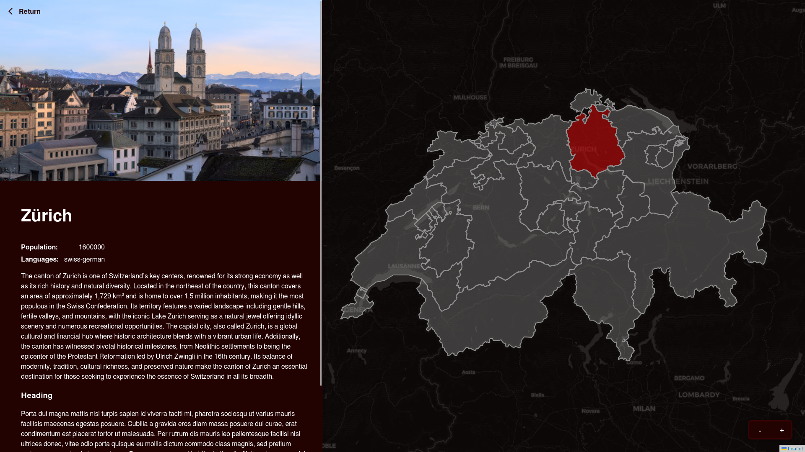
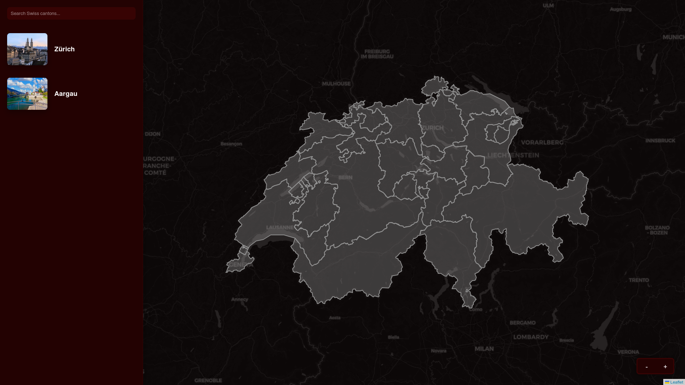
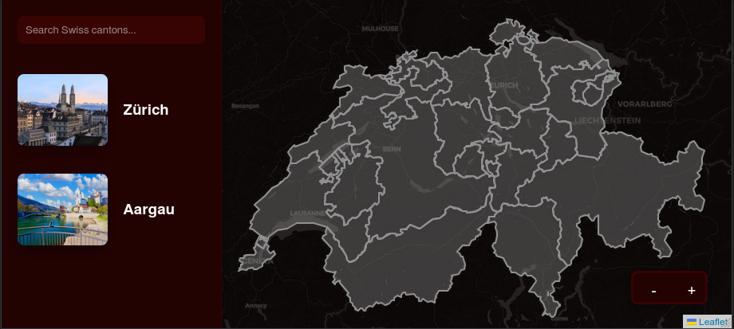

# swiss-stats

A simple web application made with React (TypeScript) that shows general information about Switzerland and its cantons.

### Main inspiration and images

All the web design is based on the Switzerland website (https://myswitzerland.com). All the images used on this project
have the Creative Commons license, and I am not the propietary. Feel free to use this project and modify it for personal or commercial
purposes.

### Features
* Responsive design (on mobiles, landscape orientation is mandatory).
* Light and dark mode
* Interactive Switzerland map, with description and images of every canton

### Screenshots

